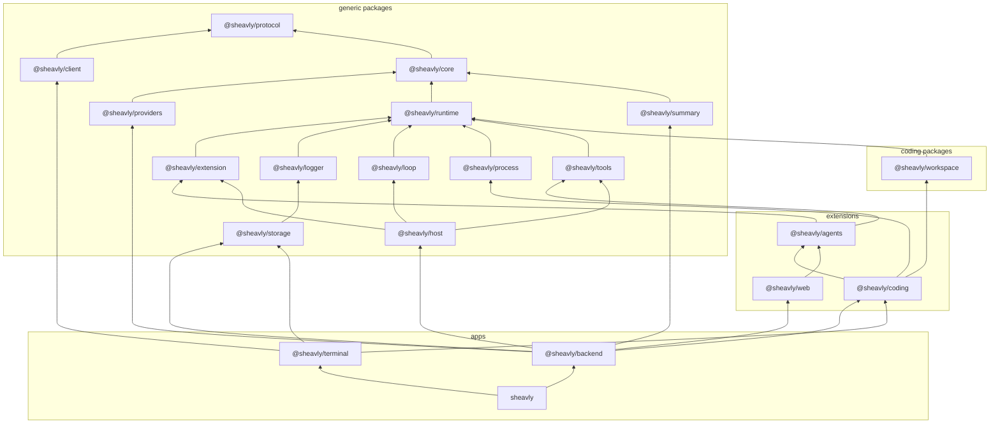

# Overview

## What it is for

In the author's words: "a typescript loop with the possibility of UI in the future that runs a
coding agent and handles everything from tool calls, reading agents.md files, handling sub
agents, background tasks." It works with any model provider, and the loop must "wait for tools,
wait for agent, wait for user, interrupt agent by user."

The harness owns the agent loop and everything it emits; a UI (or the CLI demo) only renders
events. That split decides where new work goes: if a UI would need it, the harness emits it.

**Backend only.** The harness renders nothing, prompts no one and reads no terminal input. What a
user must see or decide is a typed event or a registry request (`AgentEvent`, `SessionUpdate`,
`ApprovalUpdate`) that a UI handles its own way. UI code is written only when an issue asks for a
UI, and only in an app (`apps/*`); the shared `harness/no-terminal-io` rule fails terminal I/O in
every package, and `baseConfig` reads which workspaces are apps from where they are. Cursor injects
this rule from the `sheavly` skill's layers guide the first time a chat edits harness source.

## Layers

Imports only point down. ESLint enforces it (`harness/imports`): the workspace graph is read from
each workspace's `package.json` (its dependencies, and its `sheavly.domain`), and whether it is a
package or an app from its folder. A workspace without a domain, or an edge the graph doesn't
allow, fails lint.

Libraries live in `packages/`, front ends in `apps/`. Each arrow points from a workspace to one it
depends on, and a workspace may import everything it reaches. Generic workspaces never depend on
coding ones, nothing depends on an app, and `@sheavly/testing` and `@sheavly/eslint-config` are dev
dependencies only (not drawn). The diagram is generated from each workspace's `package.json`
(`npm run graph`), and the layout check fails when it is out of date.

<!-- graph:start (generated by `npm run graph`; do not edit) -->



<!-- graph:end -->

A new workspace comes from `npm run new` (README, "Workspace layout"); the `sheavly` skill's
"Where code goes" (`.agents/skills/sheavly/layers.md`) says which one something belongs in.

| Where                     | What lives there                                                                                                                                                                                                                                                                                                                                                                           |
| ------------------------- | ------------------------------------------------------------------------------------------------------------------------------------------------------------------------------------------------------------------------------------------------------------------------------------------------------------------------------------------------------------------------------------------ |
| `packages/protocol/src/`  | `@sheavly/protocol`, the wire contract a UI talks to, as zod schemas: `message/`, `session/`, `task/`, `approval/`, `event/`; its JSON Schema (`contract/`). zod only                                                                                                                                                                                                                      |
| `packages/core/src/`      | Code contracts only: `message/` (what a provider streams), `provider/`, `tool/`, `adapter/`, `hook/`                                                                                                                                                                                                                                                                                       |
| `packages/extension/src/` | `@sheavly/extension`, the extension lifecycle: `extension/` (the `Extension` contract, `defineExtension`, `defineService`), `manifest/` (`readManifest`, an extension's `sheavly.json`), `host/` (`ExtensionHost`), their errors (`errors/`), `instructions/` (`joinInstructions`), `approval/` (the limits on the allow entries a request may keep), the fakes (`testing/`)               |
| `packages/providers/src/` | `@sheavly/providers`, model backends: protocol layers (`responses/`, `anthropic-messages/`, sharing `http/`), backends on them (`openai/`, `azure/`: Azure OpenAI and Claude on Azure), adapter registry, `ProviderSwitch`                                                                                                                                                                 |
| `packages/runtime/src/`   | `@sheavly/runtime`, the generic services a run uses: `sessions/`, `tasks/` (background tasks), `approvals/`, `locks/` (`KeyedLocks`, serialized changes per key), and their errors; `errors/errors.utils.ts`; fakes for them in `testing/`                                                                                                                                                 |
| `packages/process/src/`   | `@sheavly/process`, the process runner: `process/` (`ProcessRunner`, `runScript`, deadlines, secret-scrubbed env), `ProcessKillError` and `ProcessInterruptedError` (`errors/`), the `testProcesses` fake (`testing/`)                                                                                                                                                                     |
| `packages/workspace/src/` | `@sheavly/workspace` (coding): the project on disk. `workspace/` (path confinement), `working-root/`, `file-reads/`, `scratch/`, their errors, and the fake `useTempWorkspace` (`testing/`)                                                                                                                                                                                                |
| `packages/tools/src/`     | `@sheavly/tools`, the generic tools: `sub-agent/` (`start_agent`, `message_agent`, `report_status`), `tasks/` (`task_status`, `cancel_task`)                                                                                                                                                                                                                                               |
| `packages/loop/src/`      | `@sheavly/loop`: `streamAgent` / `runAgent`, events, the ordered queue, abort helpers, hooks; `HookError` and `StreamEndedError` (`errors/`)                                                                                                                                                                                                                                               |
| `packages/host/src/`      | `@sheavly/host`: `createHarness`, the registries one run shares around the provider a UI picked, and `runServices` (`run-services/`), which hands them to every extension. No tools, hooks or settings of its own, and no UI                                                                                                                                                               |
| `extensions/coding/src/`  | `@sheavly/coding` (coding): the coding tools (`files/`, `read-file/`, `write-file/`, `edit-file/`, `run-command/`) and `createCodingExtension` (`extension/`: coding as an extension of a run, which opens its own workspace and process runner); the coding policy: `trust/`, `project-hooks/` (`.sheavly/`), `agents-md/`, `skills/`; their errors and `CommandRefusedError` (`errors/`) |
| `apps/backend/`           | `@sheavly/backend`, the harness backend: what each run includes (`createBackendHarness`), its settings from env, and `npm run serve -w @sheavly/backend`, its conversations over HTTP to every UI                                                                                                                                                                                          |
| `apps/terminal/`          | `@sheavly/terminal`, the terminal front end on a backend it starts: the chat, the demo (`npm run demo`: one prompt, printed as it happens), the workbook (`npm run workbook`: stored prompts, saved runs, continue, step and diff; its data is in `workbook/`), and their `Renderer`                                                                                                       |
| `apps/vscode/`            | A README for the VS Code extension, not yet a workspace                                                                                                                                                                                                                                                                                                                                    |

Every file is `<name>.<kind>.ts` (`types`, `constants`, `utils`, `validator`, `helper`, `service`,
`tool`, ...): pure code is `utils`, zod schemas for external input and their `parse*` functions
are `validator`, stateless code that does I/O is `helper`, and only code that owns state, a
class, is `service`. See `.agents/skills/sheavly/file-kinds.md` for the full conventions.

## The UI decides what a run includes

The packages provide the pieces and the services a run shares; a UI decides which provider a run
uses and which tools and hooks it includes, and composes them. No package picks a backend, a model,
a tool or a hook for it.

| Services                                    | For                                                                  | What it makes                                                                                                                                  |
| ------------------------------------------- | -------------------------------------------------------------------- | ---------------------------------------------------------------------------------------------------------------------------------------------- |
| `createHarness` (`@sheavly/host`)           | Any LLM project: text parsing and extraction, chat wrappers, no repo | The session, task and approval registries a run shares, around the provider the UI picked. Opens no workspace and reads no file                |
| `createCodingExtension` (`@sheavly/coding`) | A coding agent in a repo                                             | An extension on a harness's run services: it opens its own `Workspace`, file reads and `ProcessRunner`, and takes the `KeyedLocks` it is given |

The UI builds its tools and hooks on those: `createTaskTools(tasks)`, `createSubAgentTool({ … })`
and `createMessageAgentTool` (`@sheavly/tools`); a coding UI's `createReadFileTool({ workspace })`,
`createRunCommandTool({ processes, … })` and the rest (`@sheavly/coding`); `agentsMdSource` (built with
`createInstructionHook` from `@sheavly/core`) and, if it trusts the workspace, `loadProjectHooks` (both `@sheavly/coding`). The backend app does
it in one place, `createBackendHarness` (`apps/backend/src/harness/`), with its settings from
env; the terminal and every other UI reach its conversations over HTTP.

```ts
const harness = createHarness({ provider, title: prompt });

for await (const event of streamAgent({
  provider: harness.provider,
  instructions: harness.instructions,
  tools: [extractTool, ...createTaskTools(harness.tasks)],
  hooks: [],
  messages: [{ role: 'user', content: prompt }],
  tasks: harness.tasks,
  session: { registry: harness.sessions, ref: harness.mainSession },
}))
  render(event);
```

Pass `tasks` or `approvals` in when a tool needs the registry before the harness exists.

The rule (from [#74](https://github.com/Sheavly/code/issues/74)): generic code never needs a project on disk or a coding tool.
The loop, the generic runtime services (`sessions`, `tasks`, `approvals`), the generic tools
(`sub-agent`, `tasks`) and `createHarness` import none of the workspace-bound services
(`workspace`, `trust`, `project-hooks`, `agents-md`, `skills`) or the process runner (`@sheavly/process`, generic but only a coding run starts commands) or the coding tools
(`read-file`, `read-skill`, `write-file`, `edit-file`, `files`, `run-command`), and neither do their tests. Only
a coding UI reaches them, which is why each lives in a package of its own and the generic ones
never depend on the coding ones.

## Packages

Workspaces (`packages/*`, `apps/*`) are **built**: each compiles its own `dist/` (`.js`, `.d.ts`,
source maps) with `tsc -b`, and `npm run build` runs each workspace's build through turbo after
the ones it imports (`@sheavly/protocol`, then `@sheavly/core`, … then the apps).

A package's `exports` is its public API, declared by file kind: one entry per kind it makes
public, so every `<module>.<kind>.ts` of that kind is importable and a new module needs no entry.
Its fakes are `./testing/*`, from source only, for tests. TypeScript finds each `.d.ts` beside its
`.js`, so no `types` target is needed:

```json
"exports": {
  "./*.types": { "@sheavly/source": "./src/*.types.ts", "default": "./dist/*.types.js" },
  "./*.validator": { "@sheavly/source": "./src/*.validator.ts", "default": "./dist/*.validator.js" }
}
```

Any other kind is internal: `harness/imports` fails an import of it, and `harness/layout` fails
an entry for one file, a kind that doesn't exist or other targets. `npm run export -- packages/<pkg> <kind>`
makes a kind public, in review; an app exports nothing, except the entry files the launcher
(`apps/sheavly`) runs. A module that holds a public kind but
isn't API is closed (`"./hooks/*": null`), and the README's API table lists exactly the open
modules. The library packages are set up to ship only `dist/` and `docs/`, built by `prepack`, for when they
are published; the two apps and `@sheavly/testing` are not yet, and none is published (see
[shipping](shipping.md)).

| Where it runs            | Reads                                      | How                                                                                   |
| ------------------------ | ------------------------------------------ | ------------------------------------------------------------------------------------- |
| Dev (`demo`, `workbook`) | source                                     | `tsx --conditions=@sheavly/source`                                                    |
| Tests                    | source, with no build step before `vitest` | the condition in `vitest.config.ts`                                                   |
| Typecheck, lint          | source                                     | `customConditions` in `tsconfig.base.json`                                            |
| Production               | `dist/`                                    | `npm run build`, then plain `node` on an app's `dist/` (`apps/terminal/dist/demo.js`) |

Each package's `tsconfig.build.json` clears the condition, so a build only ever links against
another package's built output, and leaves `__tests__/` and `testing/` out: test fakes are
available from source only and never ship. `@sheavly/eslint-config` is plain JavaScript that only
ESLint loads, so it isn't built.

Why built, not source only: a harness others embed has to run on plain Node without a TypeScript
loader. Why `tsc -b`, not a bundler or a task runner: the source already uses `.js` imports and
`nodenext`, so `tsc`'s output is what Node runs, one file per exported subpath. A bundler (Vite
library mode, tsup) would merge those files and needs a plugin for declarations. Turborepo only
orders and caches each workspace's `build` script on top of it.

## The wire contract

`@sheavly/protocol` is the bottom layer: everything the harness sends a UI or accepts from one
(`AgentEvent`, `SessionUpdate`, `ApprovalUpdate`, `ApprovalResponse` and the types inside them),
defined once as zod schemas. Every type is `z.infer` of its schema, so the TypeScript types and
what goes over the wire can't drift. It depends on zod only; its `eslint.config.js` keeps the
other workspace packages out.

- A TypeScript UI imports the types (`@sheavly/protocol/event/event.types`) and can parse what it
  receives with the schemas (`event.validator`).
- Any other client reads `packages/protocol/contract.schema.json`, the whole contract as one JSON
  Schema (draft 2020-12, every type under `$defs`). `npm run schema -w @sheavly/protocol` writes it
  from the schemas, and a test fails when the committed file is out of date.
- A loop test (`wire-contract.test.ts`) parses every event and session update of a scripted run
  against its schema.
- Only the wire contract lives there. What a provider streams (`StreamEvent`, `StopReason`) and
  the code contracts (`Tool`, `Hook`, `Adapter`) stay in `@sheavly/core`, and the queue's generic
  `Sequenced<T>` in the loop.

## The provider contract

A provider (`packages/core/src/provider/`) is one method, `stream(request)`, returning
`StreamEvent`s. Every model call gets a fresh `ProviderRequest`:

| Field          | What it is                                                                                                                               |
| -------------- | ---------------------------------------------------------------------------------------------------------------------------------------- |
| `instructions` | System instructions for this call, or none: the run's `instructions` option, then what `beforeTurn` hooks added, joined with blank lines |
| `messages`     | The conversation history (a copy): user, assistant and tool messages                                                                     |
| `cacheKey`     | The session id: an adapter maps it to its backend's cache routing key, or ignores it                                                     |
| `tools`        | The tool definitions (name, description, JSON schema)                                                                                    |
| `signal`       | Aborts the call                                                                                                                          |

The host composes the system prompt at each read: the generic core (or a replacement), then the
sections the extensions contribute (coding guidance is the `coding` extension's section), then the
app's own extras.
Conversations use them by default; an explicit conversation string remains a complete override.
Children receive explicitly injected shared text before their role. All models use the same text.
See [instruction composition](../packages/host/docs/harness.md#instruction-composition).

Before-turn system additions are rebuilt each turn and never stored in `messages`. Changed
AGENTS.md and skills instead append deduplicated context to history, preserving signed-thinking
prefixes. The Responses client sends system text as the API's `instructions` field.

The agent also sees how full its context is. A provider may report its model's `contextWindow`;
the loop gives each request one line, `Context: 48,210 of 400,000 tokens used (12%)`, as its
`notice`, which a provider sends as a last user message after the history. That line is for the
model only: it changes every turn, so it never goes through `instructions` or into history, and
the cached prefix stays the same. Hooks get the same numbers in
`beforeTurn`'s `context`, and a UI gets the window on each `usage` event, since the harness renders
nothing itself. See [a run](../packages/loop/docs/run.md#context-usage).

Every turn resends nearly the same prompt, so providers cache its prefix: `instructions`, `tools`,
then `messages`. The loop sends the session id as `cacheKey` (a sub-agent has its own), the
Messages adapter opts in with `cache_control` and ends the cached prefix before the notices, and
the Responses adapter sends `prompt_cache_key`. What must stay stable between turns, and how each
backend caches, is in [prompt caching](../packages/providers/docs/prompt-caching.md).

## One run

`streamAgent(options)` returns an async iterable of events, each with a gap-free `seq`:

1. `sessionStart` hooks run (they may add context).
2. Each turn: finished background tasks are reported, messages sent to the session meanwhile
   (steering) are added, `beforeTurn` hooks run (they may add
   context and this turn's system instructions), then the model is called. Text and reasoning
   stream out as they arrive.
3. Tool calls start the moment the model asks for them, each wrapped by `aroundToolCall` hooks.
   Their results are released after the turn ends (`tool_batch`, `tool_result`), each as its tool
   finishes; a UI matches a result to its call by id, and history keeps call order.
   A `tool_result` can carry `artifacts`, the tool's data for a UI (a file write's before and
   after, which lines a read covered); the model sees only the text, a UI renders these.
4. `afterTurn` hooks run. If the model called tools, the next turn starts; otherwise the run ends
   (or waits for its non-service background tasks and their completion notices).
5. `done` is always last and carries the full history, valid to continue from, and the run's
   session (every run is a session with an id; see [sessions](../packages/runtime/docs/sessions.md)).

Aborting the signal stops cleanly at any point: unfinished tools get an "interrupted" result, so
history stays valid. If the run fails, `onError` hooks are told and the error is rethrown; an
`onError` handler that fails is reported as a `hook_failed` event, never in place of that error. A
model call that fails after it started tools (a cut-off stream, an error event) first stops those
tools and emits their results, so every `tool_call_started` is answered, then fails the run.

## Trust model

The harness is for **trusted local repositories**. It checks what the agent asks for, but it is
not an OS sandbox: nothing isolates the processes it runs from the rest of the machine. For a repo
you don't trust, run the harness in a container or VM.

What `Workspace` (`@sheavly/workspace/workspace/`) and the tools enforce is **path confinement**:

- The file tools resolve every path inside the workspace root and refuse anything that ends up
  outside it (`../`, absolute paths, symlinks out). `.env` files are refused by name, and changes
  (writes and deletes) inside `.git` are refused
  ([file tools](../extensions/coding/docs/file-tools.md)). The one exception is the optional shared
  scratch folder (`<tmpdir>/sheavly` in the backend).
- `run_command` runs commands without a shell (a line may chain them with `|`, `&&`, `||` and
  `;`), asks the user before any command they have not allowed, checks the arguments of every
  command with the same path rules, asks for approval when one reaches outside or can name a
  `.env` file, and sets git config that blocks most ways a repo can make git run programs
  ([run_command](../extensions/coding/docs/run-command.md)).
- Commands get the harness's env without the variables whose names look like secrets (`KEY`,
  `SECRET`, `TOKEN`, `PASSWORD`, `CREDENTIAL`). This is a filter on names, not complete scrubbing:
  a secret in a value under another name (`DATABASE_URL`), `SSH_AUTH_SOCK` and credential files
  the user can read (`~/.npmrc`, `~/.aws/credentials`) still reach commands.

What runs with the user's full rights, outside those checks:

- **Allowed commands, and anything they execute.** `npm test` runs the repo's npm scripts, test
  config and test files; those can read, write or send anything the user can. Argument checks
  don't reach inside them. Isolating commands is [#4](https://github.com/Sheavly/code/issues/4).
- **Everything, in a folder set to `allow_all`.** The user can tell a folder to run every command
  without asking, argument checks and approvals included. It is a choice for one folder, kept in
  their own folder where the agent can't change it, and a conversation reports it in its details.
- **`delete_file`.** It removes one file without an approval, like the other file tools: only
  `run_command` asks. It refuses a folder, a symlink, a `.env` file and a path outside the
  workspace, and reports the content it read under the lock unless the file is over 100,000 bytes.
- **Git filter drivers a repo brings.** A filter defined in a cloned repo's `.git/config` and
  named in a committed `.gitattributes` still runs when an allowed `git status` or `git diff`
  does; on git older than 2.42, so does one an edited `.gitattributes` turns on.
- **`.sheavly/` project hooks.** They run inside the harness process, with its rights and its env
  (keys included). They load only in a workspace the user trusted, and only until `.sheavly/`
  changes ([workspace trust](../extensions/coding/docs/project-hooks.md#workspace-trust)), but once loaded nothing confines what they do.

## Errors

The harness fails loudly, and ESLint enforces it in every workspace and on `.cursor/hooks/`:

- `harness/no-silent-catch`: a `catch` either rethrows or checks what it caught (an error code, a
  class) and handles only what it expects, so no failure turns silently into a default.
- `harness/permission-store-root` (backend): every call on the permission store is keyed by
  `permissionRoot`, so a repo's worktrees share one mode and allow list.
- `harness/no-raw-error`: source never creates a plain `Error`. Every error is a typed class,
  with a `name` and the fields to act on, keeping the original as `cause`, so a caller catches it
  by class instead of by message. Tests, fakes and root `scripts/` are exempt.

Each area keeps its own classes, since the layers can't all import one another:

| Where                            | Classes                                                                                 |
| -------------------------------- | --------------------------------------------------------------------------------------- |
| `packages/core/src/errors/`      | `DefinitionError`: a tool or hook defined wrong; `ToolCallError`: a tool refused a call |
| `packages/loop/src/errors/`      | `HookError`, `StreamEndedError`                                                         |
| `packages/providers/src/errors/` | `AdapterError`, `ModelApiError`, `ProviderSwitchError`                                  |
| `packages/runtime/src/errors/`   | `SessionError`, `ApprovalRequestError`, `ApprovalListenerError`; `errors.utils.ts`      |
| `packages/process/src/errors/`   | `ProcessKillError`, `ProcessInterruptedError`                                           |
| `packages/workspace/src/errors/` | The project on disk: `WorkspaceError`, `PathCheckError` (below)                         |
| `extensions/coding/src/errors/`  | `CommandRefusedError`, and trust, project hooks, AGENTS.md and skills (below)           |
| `apps/terminal/src/errors/`      | The workbook's (below)                                                                  |
| `.cursor/hooks/hooks.errors.mjs` | `HookStateError`, `ProjectReadError`, `GuardCrashError`                                 |

| Class                                  | Package              | Thrown when                                                                 |
| -------------------------------------- | -------------------- | --------------------------------------------------------------------------- |
| `WorkspaceError`                       | `@sheavly/workspace` | A path is outside the workspace, or a broken symlink                        |
| `PathCheckError` (`path`, `code`)      | `@sheavly/workspace` | A path couldn't be checked at all (`EACCES`, `ELOOP`); never "missing"      |
| `ProjectHooksError`                    | `@sheavly/coding`    | `.sheavly/` hooks can't be read, validated or loaded                        |
| `ProcessKillError` (`pid`, `code`)     | `@sheavly/process`   | A command's process group couldn't be stopped; it may still be running      |
| `ProcessInterruptedError`              | `@sheavly/process`   | The run was interrupted before a command started                            |
| `AgentsMdError` (`root`, `cwd`)        | `@sheavly/coding`    | The working directory is outside the project root                           |
| `TrustStoreError` (`file`)             | `@sheavly/coding`    | The workspace trust store exists but can't be read, parsed or written       |
| `ApprovalRequestError` (`reason`)      | `@sheavly/runtime`   | No one listens for approvals, or an answer names no waiting request         |
| `ApprovalListenerError` (`update`)     | `@sheavly/runtime`   | An approval subscriber threw                                                |
| `SessionError` (`reason`, `sessionId`) | `@sheavly/runtime`   | A session operation was refused (unknown, ended, too deep, not an ancestor) |
| `CommandRefusedError` (`reason`)       | `@sheavly/coding`    | A command needed approval nobody could give, or the user skipped it         |
| `WorkbookStoreError` (`file`)          | `@sheavly/terminal`  | A workbook file exists but can't be read or parsed                          |
| `WorkbookNotFoundError` (`wanted`)     | `@sheavly/terminal`  | A stored prompt, run or saved conversation isn't there                      |
| `WorkbookPromptError` (`prompt`)       | `@sheavly/terminal`  | A stored prompt file has bad front matter                                   |

`@sheavly/runtime/errors/errors.utils` has `errorMessage`, `errorCode` and `isMissingPath`
(`ENOENT` / `ENOTDIR` only).

## Where the next work goes

- Something sent to or accepted from a UI (an event, an update, an answer): a zod schema in
  `packages/protocol/src/<module>/<module>.validator.ts`, its type inferred in
  `<module>.types.ts`; then `npm run schema -w @sheavly/protocol` (see "The wire contract").
- A code contract other packages depend on (a tool, a hook, a provider): `packages/core/src/<module>/`.
- A model backend: `packages/providers/src/<name>/<name>.adapter.ts`, with `defineResponsesAdapter`
  for a Responses API backend; another protocol gets its own folder next to `responses/` (see
  [the package README](../packages/providers/README.md)).
- A tool: a generic one in `packages/tools/src/<name>/`, one that touches files or runs commands in `extensions/coding/src/<name>/` (see [writing a tool](../packages/core/docs/tools.md)).
- A new hook point: an optional handler on `Hook` (see [hooks](../packages/core/docs/hooks.md)).
- Something a UI must show: a new event in `agentEventBodySchema`
  (`packages/protocol/src/event/event.validator.ts`).
- How Sheavly is installed and run (the published packages, the `sheavly` command, the always-on
  backend): the decisions are in [shipping](shipping.md).
